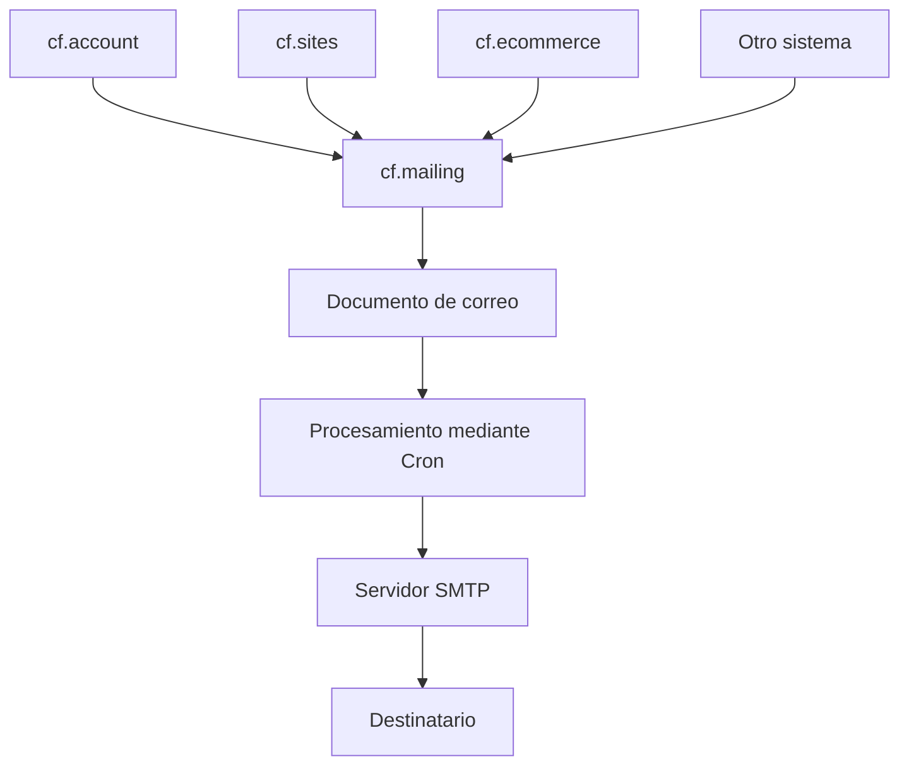
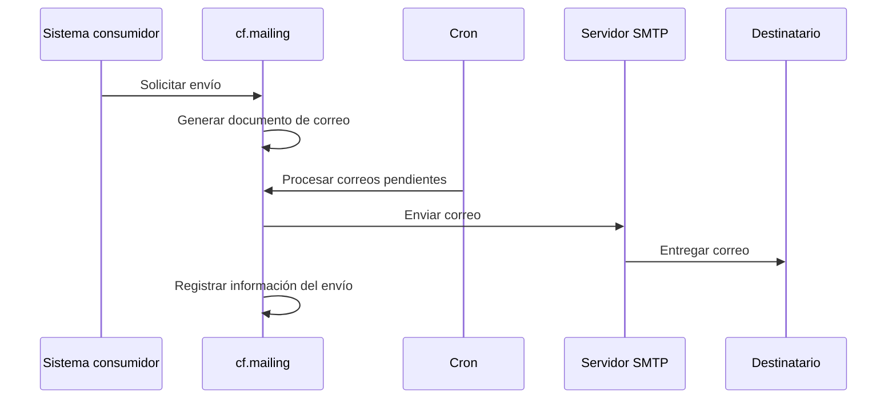
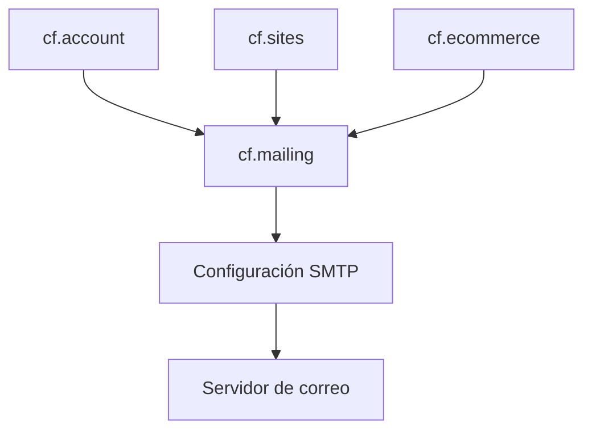
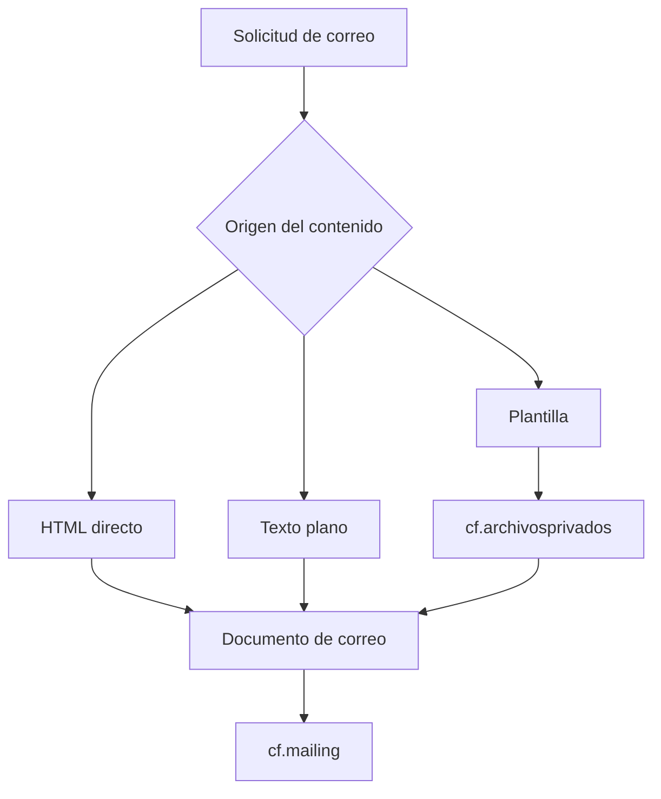
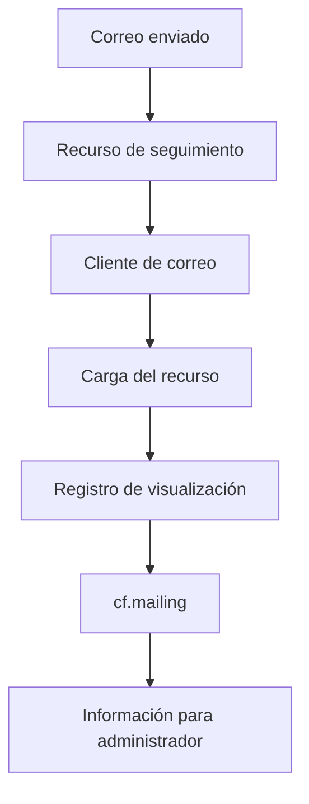

# Sistema de Mailing

`cf.mailing` es un componente esencial del [**proyecto trascender**](https://github.com/jotacalderon90/), encargado de centralizar la **gestión, procesamiento y envío de correos electrónicos** dentro del ecosistema.

Su objetivo es proporcionar un servicio común para que los diferentes sistemas de Trascender puedan solicitar el envío de correos sin tener que implementar individualmente la configuración SMTP, generación de mensajes, procesamiento de envíos, programación de tareas y seguimiento de apertura.

Los sistemas consumidores, como `cf.account`, `cf.sites`, `cf.ecommerce` y otros componentes del ecosistema, pueden solicitar internamente el envío de un correo proporcionando los parámetros necesarios para generar el documento que posteriormente será procesado y enviado por `cf.mailing`.

---

## Rol dentro del ecosistema

Dentro de Trascender, `cf.mailing` actúa como un **servicio transversal de comunicaciones electrónicas**.

Los sistemas que requieren enviar un correo no necesitan implementar directamente:

* Configuración SMTP
* Conexión con el servidor de correo
* Generación del mensaje
* Procesamiento de la cola de correos
* Programación de los envíos
* Gestión de plantillas
* Seguimiento de aperturas
* Registro asociado al proceso de envío

Estas responsabilidades son delegadas a `cf.mailing`.

De esta manera, los diferentes sistemas pueden concentrarse en su propia lógica de negocio y utilizar un mecanismo común para generar y enviar comunicaciones electrónicas.

---

## Integración con otros sistemas

Los sistemas de Trascender pueden utilizar `cf.mailing` cada vez que necesitan enviar un correo electrónico.

Entre los posibles consumidores se encuentran:

* `cf.account`
* `cf.sites`
* `cf.ecommerce`
* Sistemas administrativos
* Nuevos componentes desarrollados sobre `cf.framework`

La relación es de tipo **solicitud de servicio**: el sistema consumidor genera la información necesaria para el correo y solicita internamente a `cf.mailing` que genere el documento correspondiente.

Conceptualmente:



El sistema consumidor no necesita realizar directamente la conexión SMTP ni encargarse del proceso de envío.

---

## Flujo de envío

El proceso de envío se divide conceptualmente en diferentes etapas.



Este modelo permite que los sistemas consumidores deleguen el procesamiento del envío a un componente especializado.

---

## Configuración SMTP

`cf.mailing` centraliza la configuración necesaria para comunicarse con el servidor SMTP utilizado para los envíos.

Esto permite que los sistemas consumidores no tengan que conocer ni administrar directamente las credenciales o parámetros asociados al servidor de correo.

Conceptualmente:



La configuración SMTP queda, de esta forma, bajo la responsabilidad del componente especializado en comunicaciones.

---

## Plantillas de correo

`cf.mailing` permite utilizar plantillas de correo para agilizar la generación de comunicaciones automáticas.

Mediante su integración con `cf.archivosprivados`, es posible definir y administrar plantillas que pueden ser utilizadas posteriormente por los sistemas consumidores.

Esto permite mantener separada la definición visual o documental del correo respecto de la lógica que desencadena su envío.

Las plantillas pueden utilizarse para escenarios recurrentes como:

* Recuperación de contraseña
* Confirmaciones
* Notificaciones
* Comunicaciones automáticas
* Mensajes administrativos
* Otros procesos definidos por los sistemas consumidores

La disponibilidad de plantillas permite reutilizar estructuras de correo y reducir la necesidad de generar manualmente el contenido en cada sistema.

---

## Formatos de correo

El sistema contempla diferentes formas de generar el contenido del mensaje.

### HTML

Permite generar correos electrónicos con contenido HTML, incluyendo estructuras visuales y contenido dinámico.

### Texto plano

También permite generar mensajes simples utilizando texto plano cuando no se requiere una estructura HTML.

### Plantillas

Los sistemas pueden utilizar plantillas previamente definidas para generar automáticamente el contenido del correo.

Conceptualmente:



---

## Seguimiento de apertura

Una de las capacidades importantes de `cf.mailing` es la generación de información asociada a la **visualización de los correos enviados**.

El sistema genera un documento que permite posteriormente determinar si existe evidencia de que el correo fue cargado por el cliente destinatario.

Esta información puede ser utilizada por el administrador final para conocer el comportamiento de las comunicaciones enviadas.

Conceptualmente:



---

## Consideraciones sobre las aperturas

La información de apertura debe interpretarse como **evidencia técnica de carga del correo**, y no necesariamente como confirmación de que una persona leyó su contenido.

Los clientes y proveedores de correo electrónico pueden realizar cargas automáticas de recursos.

Entre estos comportamientos se encuentran mecanismos utilizados por servicios como Gmail, Outlook y otros sistemas de correo para analizar, almacenar, proteger o previsualizar contenido.

Por este motivo, `cf.mailing` permite generar información que posteriormente puede ayudar a distinguir entre:

* Cargas asociadas a clientes o destinatarios
* Cargas automáticas
* Actividad generada por bots o mecanismos de protección de proveedores de correo

El objetivo es proporcionar información adicional al administrador para que pueda interpretar el comportamiento de los envíos, considerando las limitaciones propias del seguimiento mediante recursos remotos.

---

## Tecnologías

### Backend

* Node.js
* Express (a través de `cf.framework`)
* Nodemailer
* Zod
* Luxon
* Node Cron

### Dependencias principales

```json
{
  "cl.jotacalderon.cf.framework": "1.9.0",
  "nodemailer": "8.0.7",
  "zod": "4.1.12",
  "luxon": "3.7.2",
  "node-cron": "4.2.1"
}
```

### Responsabilidad de las principales dependencias

* **cf.framework:** infraestructura común utilizada por el ecosistema.
* **Nodemailer:** gestión de la comunicación y envío mediante SMTP.
* **Zod:** validación de la información recibida y procesada.
* **Luxon:** manejo de fechas y horas.
* **Node Cron:** ejecución programada del procesamiento de correos pendientes.

---

## Seguridad

La centralización del servicio permite evitar que cada aplicación tenga que administrar directamente las credenciales SMTP.

Los sistemas consumidores solicitan el envío a `cf.mailing`, mientras que la configuración necesaria para realizar la comunicación con el servidor de correo permanece bajo responsabilidad del componente.

Esto permite establecer un punto común para controlar y administrar la infraestructura relacionada con los envíos.

---

## Ejecución local

### Con Node.js

```bash
npm install
npm run dev
```

Para producción:

```bash
npm run start
```

---

## Con Docker

Modo desarrollo:

```bash
docker-compose -f docker-compose.dev.yml build
docker-compose -f docker-compose.dev.yml up
```

Modo producción:

```bash
docker-compose build
docker-compose up
```

---

## Principios

`cf.mailing` se construye sobre los siguientes principios:

* **Centralización:** un único componente administra la infraestructura de correo del ecosistema.
* **Desacoplamiento:** los sistemas consumidores no necesitan implementar directamente SMTP.
* **Asincronía:** la generación del correo puede separarse de su procesamiento y envío.
* **Reutilización:** las plantillas pueden ser utilizadas por diferentes sistemas.
* **Trazabilidad:** los envíos generan información que permite conocer su procesamiento y comportamiento posterior.
* **Extensibilidad:** nuevos sistemas pueden integrarse utilizando el mismo mecanismo de solicitud.
* **Especialización:** la lógica de negocio permanece en el sistema consumidor y la gestión del correo en `cf.mailing`.

---

## Notas

* `cf.mailing` es un componente transversal del ecosistema Trascender.
* Los sistemas consumidores son responsables de determinar cuándo y por qué necesitan enviar un correo.
* `cf.mailing` es responsable de generar, procesar y enviar el correo.
* La configuración SMTP se centraliza en este componente.
* El envío efectivo es procesado mediante una tarea programada con `node-cron`.
* Se soporta contenido HTML y texto plano.
* Las plantillas pueden integrarse con `cf.archivosprivados`.
* El seguimiento de apertura representa evidencia técnica de carga y no garantiza que el destinatario haya leído el contenido.
* Los mecanismos automáticos de los proveedores de correo pueden generar aperturas que no necesariamente corresponden a una interacción humana.

---

## Continuidad del ecosistema

`cf.mailing` forma parte de los componentes esenciales de **Trascender**, proporcionando una infraestructura común para las comunicaciones electrónicas generadas por los diferentes sistemas de la plataforma.

Junto con los demás componentes del ecosistema:

* `cf.archivospublicos` → administración de recursos públicos.
* `cf.account` → gestión de identidad, autenticación y control de acceso.
* `cf.database` → gestión documental y administración de información.
* `cf.archivosprivados` → gestión de archivos privados.
* `cf.mailing` → gestión, procesamiento, envío y seguimiento de correos electrónicos.

La incorporación de este componente permite que los nuevos sistemas desarrollados sobre Trascender puedan disponer de un mecanismo común de comunicación electrónica sin tener que implementar nuevamente la infraestructura necesaria para generar y enviar correos.

El siguiente componente del ecosistema corresponde al sistema público web WWW:

[https://github.com/jotacalderon90/cf.sites](https://github.com/jotacalderon90/cf.sites)
